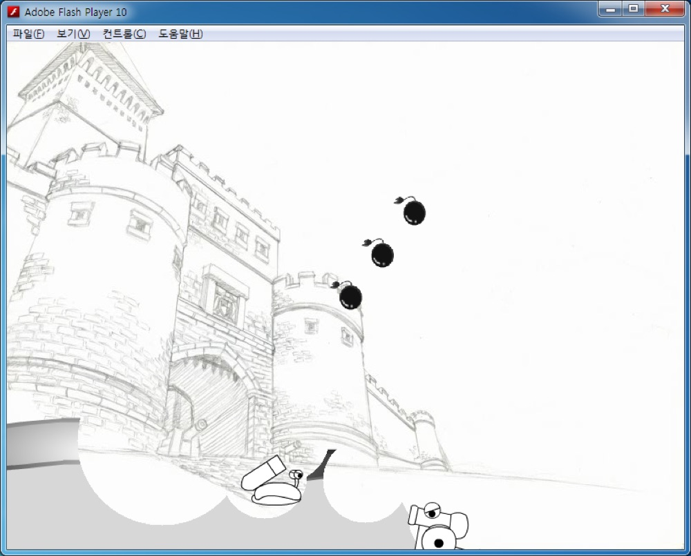

# Fortress

두 사람이 한 키보드로 번갈아 포탄을 쏘는 2인용 포트리스 게임이다. 방향키로 대포를 움직이고 스페이스바로 힘을 모아 쏘며, 포탄이 떨어진 자리는 지형이 둥글게 파인다. 체력이 다 닳거나 파인 구멍으로 맵 아래까지 떨어진 쪽이 진다. Adobe Flash CS5.5 와 액션스크립트 3.0 으로 만든 학교 과제다.

<p>
  
</p>


## 플레이 방법

Releases에서 받아 Flash Player 로 swf 를 열면 된다. 배경음악과 효과음은 swf 옆의 `Sounds` 폴더에서 읽는다. 메인 메뉴의 Game Start 로 시작하고, How To 와 Credit 은 설명 창과 제작자 창을 띄운다.

| 키 | 동작 |
|---|---|
| 왼쪽, 오른쪽 방향키 | 이동 |
| 위 방향키 | 점프 |
| 스페이스 누르고 있기 | 힘 모으기. 다 차면 저절로 쏜다 |
| 스페이스를 누른 채 위, 아래 방향키 | 발사각 조절 (15도에서 45도) |
| 스페이스 떼기 | 발사 |

자기 차례인 대포만 움직일 수 있고, 쏘고 나면 차례가 상대에게 넘어간다. 포탄과 불길이 다 사라질 때까지는 둘 다 조작할 수 없다. 한 턴에 움직일 수 있는 거리는 200픽셀이고 대포 위의 파란 막대로 보인다. 쏘면 반동으로 대포가 뒤로 밀린다.

포탄이 땅에 닿으면 반지름 50픽셀만큼 지형을 지우고 불길을 남긴다. 불길에 닿아 있는 대포는 체력 100 에서 매 프레임 0.25 씩 깎인다. 쏠 때마다 1/5 확률로 아이템 상자가 하늘에서 떨어지고, 상자를 먹은 대포는 다음 한 발이 둘 중 하나로 바뀐다. 지금 쏠 포탄의 종류는 화면 왼쪽 위에 표시된다.

| 아이템 | 효과 |
|---|---|
| Big Bombing | 지형을 반지름 100픽셀로 지우고 큰 불길 세 개를 남긴다 |
| Carpet Bombing | 포탄 세 발을 조금씩 다른 거리로 쏜다 |

승부가 나면 결과 창이 뜨고, 창을 누르면 메인 메뉴로 돌아간다.


## 구현 원리

**게임메이커의 이벤트 구조를 액션스크립트 위에 다시 만들었다.** 스테이지의 `ENTER_FRAME` 과 키보드 이벤트를 받아 매 프레임 키 상태에 따른 KeyPress, KeyDown, KeyRelease 이벤트와 Step 이벤트를 오브젝트에 나눠 주고, Create, Collision, Destroy, 마우스 이벤트도 오브젝트 종류로 분기하는 함수로 만들었다. 라이브러리 심볼마다 `ObjCannon` 같은 클래스 이름을 붙여 두고 `InstanceCreate`, `InstanceDestroy`, `InstanceNumber`, `PlaceFree`, `MoveContact`, `LengthdirX`, `PointDirection` 같은 게임메이커 함수를 같은 이름으로 옮겼다. 게임메이커의 `with` 문은 익명 함수를 넘기는 `With` 로 흉내 냈다. 뷰는 매 프레임 끝에 모든 인스턴스의 좌표에서 뷰 위치를 빼 두었다가 다음 프레임 처음에 되돌리는 식으로 만들어, 폭 3000픽셀의 맵을 800x600 화면으로 따라간다.

```actionscript
var controlTurn;
With(id, ObjGame, function (id, other){
	 controlTurn = id.currentControl;
});
```

**지형은 비트맵으로 판정하고 지운다.** 지형 심볼을 처음에 `BitmapData` 로 한 번 그려 두고, 충돌은 `BitmapData.hitTest` 로 불투명한 픽셀끼리 겹치는지 본다. 포탄이 닿으면 그 자리를 중심으로 원 안의 픽셀을 `setPixel32` 로 투명하게 칠해 구멍을 낸다.

**포탄의 초속은 사거리 공식을 거꾸로 풀어 구한다.** 모은 힘과 발사각으로 목표 지점을 정하고, 수평 거리와 중력을 사거리 공식 R = v² sin2θ / g 에 넣어 v 를 구한다. 중력은 모은 힘에 따라 0.1 에서 0.3 사이로 정해지고, 날아가는 동안 매 프레임 속도에 더해져 포물선이 된다.

```actionscript
vector1 = (distance * gravity);
vector2 = LengthdirX(1, angle);
vector3 = LengthdirY(1, angle);
speed = Math.sqrt(vector1 / (2 * Math.abs(vector2 * vector3)));
```

**경사면은 기울기 한계로 오르내린다.** 대포는 `gradeAbility` 60도의 탄젠트에 좌우속도(최소 1)를 곱한 높이까지 올라설 수 있다. 앞이 막히면 그 높이만큼 들어 올린 자리가 비었는지 보고 올라선 뒤 `MoveContact` 로 땅에 붙이고, 내리막에서는 같은 높이 안에서 아래로 붙여 경사를 타고 내려간다.


## 파일

| 경로 | 내용 |
|---|---|
| `source/Fortress.fla` | Flash CS5.5 프로젝트 파일 |
| `source/Scripts.txt` | fla 의 첫 프레임에 들어 있는 액션스크립트 전체를 옮긴 텍스트 |
| `source/Sounds/` | 배경음악과 효과음. swf 가 실행 중에 읽는다 |
| `docs/screenshots/` | 스크린샷 |
| Releases | swf 와 소리 파일 |


## 크레딧

경사면 이동, 포물선 운동, 지형 파괴 코드는 다음 글을 참고했다.

- 경사면 이동: [cafe.naver.com/gmopensource/578](http://cafe.naver.com/gmopensource/578)
- 포물선 운동: [cafe.naver.com/playgm/71681](http://cafe.naver.com/playgm/71681)
- 지형 파괴: [codeonwort.tistory.com/31](http://codeonwort.tistory.com/31)


## 라이선스

CC BY-NC-ND 4.0 라이선스다. 출처를 밝히면 비상업 용도로 그대로 공유할 수 있고, 수정본 배포와 상업적 이용은 금지한다. 함께 들어 있는 것 중 다른 사람이 만든 라이브러리와 그림·소리·맵은 각자의 권리를 따른다. 자세한 내용은 [LICENSE](LICENSE) 에 있다.
